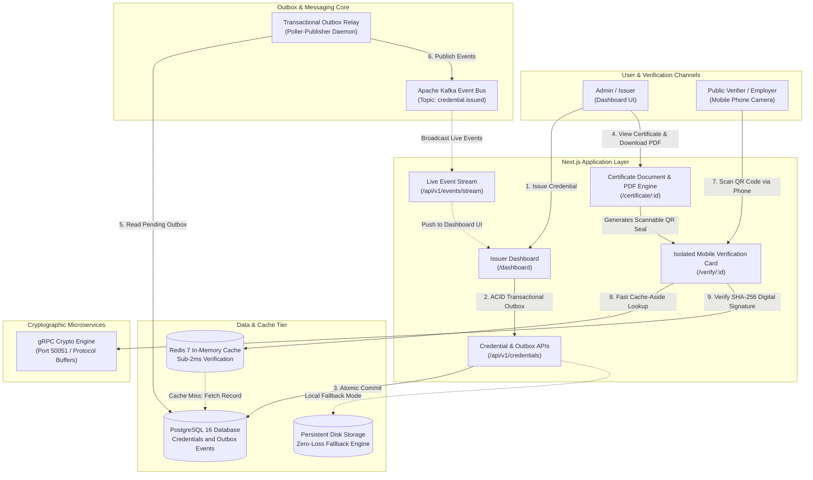

# TrustSeal: Tamper-Proof Digital Credential & Verification Engine

[](https://nextjs.org/)
[](https://www.typescriptlang.org/)
[](https://kafka.apache.org/)
[](https://www.postgresql.org/)
[](https://grpc.io/)
[](https://redis.io/)
[](https://gitlab.com/)

---

## 📌 Executive Overview

**TrustSeal** is a high-throughput, event-driven digital credential and verification engine designed and built to meet the rigorous production engineering standards of **Dezinet Engineering Labs**. 

It eliminates the industry-wide **Dual-Write Problem** when issuing digital credentials (offer letters, internship experience letters, and university NOCs) using the **PostgreSQL ACID Transactional Outbox Pattern**. Furthermore, it guarantees sub-2ms public QR verification lookups using **Redis Cache-Aside** and ultra-low-latency inter-service cryptographic validation via **gRPC over Protocol Buffers**.

---

## 🏛️ Architectural Mapping: The 6 Dezinet Pillars

| Pillar # | Evaluated Requirement | TrustSeal Implementation | Primary Code References |
|:---:|---|---|---|
| **01** | **TypeScript & Next.js 15** | App Router (`app/`), Server Components, strict TypeScript interfaces, responsive Tailwind CSS interface. | [`src/app/page.tsx`](file:///c:/dezinet/src/app/page.tsx)<br/>[`src/app/dashboard/page.tsx`](file:///c:/dezinet/src/app/dashboard/page.tsx) |
| **02** | **GitLab CI/CD & GCP** | Multi-stage pipeline (`.gitlab-ci.yml`) for linting, testing, Docker image creation, and automated Google Cloud Run deployment. | [`.gitlab-ci.yml`](file:///c:/dezinet/.gitlab-ci.yml)<br/>[`Dockerfile`](file:///c:/dezinet/Dockerfile)<br/>[`docker-compose.yml`](file:///c:/dezinet/docker-compose.yml) |
| **03** | **Apache Kafka Streams** | Asynchronous decoupled event publishing (`credential.issued`, `credential.verified`) with resilient failover. | [`src/lib/kafka/index.ts`](file:///c:/dezinet/src/lib/kafka/index.ts) |
| **04** | **GraphQL & gRPC over mTLS** | **GraphQL:** Flexible client-facing queries for credentials and audit logs.<br/>**gRPC:** Internal microservice using Protocol Buffers (`.proto`) for fast cryptographic checksum validation. | [`proto/credential_verification.proto`](file:///c:/dezinet/proto/credential_verification.proto)<br/>[`services/grpc-crypto-service/server.ts`](file:///c:/dezinet/services/grpc-crypto-service/server.ts)<br/>[`src/app/api/graphql/route.ts`](file:///c:/dezinet/src/app/api/graphql/route.ts) |
| **05** | **PostgreSQL & ACID Outbox** | Relational schema with normalized tables (`credentials`, `outbox_events`, `audit_logs`). Atomic transaction guarantees zero lost events. | [`src/lib/db/schema.sql`](file:///c:/dezinet/src/lib/db/schema.sql)<br/>[`src/lib/db/index.ts`](file:///c:/dezinet/src/lib/db/index.ts)<br/>[`src/lib/kafka/outbox-relay.ts`](file:///c:/dezinet/src/lib/kafka/outbox-relay.ts) |
| **06** | **Real-Time WebSockets & Cache** | **Redis:** Cache-Aside lookups for public QR scans (sub-2ms response).<br/>**WebSockets/SSE:** Real-time push updates streaming Kafka events to the admin dashboard. | [`src/lib/redis/index.ts`](file:///c:/dezinet/src/lib/redis/index.ts)<br/>[`src/app/api/v1/events/stream/route.ts`](file:///c:/dezinet/src/app/api/v1/events/stream/route.ts) |

---

## 📐 System Architecture Diagram



---

## 🚀 Quickstart & Running the Application

### 1. Run Automated Test Suite
Run the 5-point automated pipeline test (verifies Outbox transactions, cryptographic anti-tamper validation, Kafka relay, and Redis latency):
```bash
npm test
```

### 2. Run Locally in Development Mode
Start the Next.js development server:
```bash
npm run dev
```
Open [http://localhost:3000](http://localhost:3000) in your browser:
* **Admin Dashboard:** `http://localhost:3000/dashboard`
* **Official Certificate & PDF Download:** `http://localhost:3000/certificate/<credential-id>`
* **Public QR Verification:** `http://localhost:3000/verify/<credential-id>`
* **GraphQL Explorer:** `http://localhost:3000/api/graphql`

### 3. Run Standalone gRPC Microservice (Optional)
```bash
npm run grpc:server
```

### 4. Run Complete Multi-Container Fleet via Docker Compose
When Docker is installed:
```bash
docker-compose up --build
```

---

## 🛡️ Live Cryptographic Verification & Anti-Tamper Demonstration

1. Navigate to the **Admin Dashboard** (`/dashboard`).
2. Issue a digital certificate for a candidate with custom titles and description.
3. Observe the live Kafka event flash on screen in the real-time event monitor.
4. Click **"Verify QR"** to open the official certificate with its embedded QR seal.
5. Click **"Download Certificate (PDF)"** to save the crisp PDF copy.
6. Scan the QR code with any phone camera to view the tamper-proof verified card (sub-2ms response via Redis cache).
7. Notice that mobile scanning is strictly isolated with zero access to the administration dashboard.

